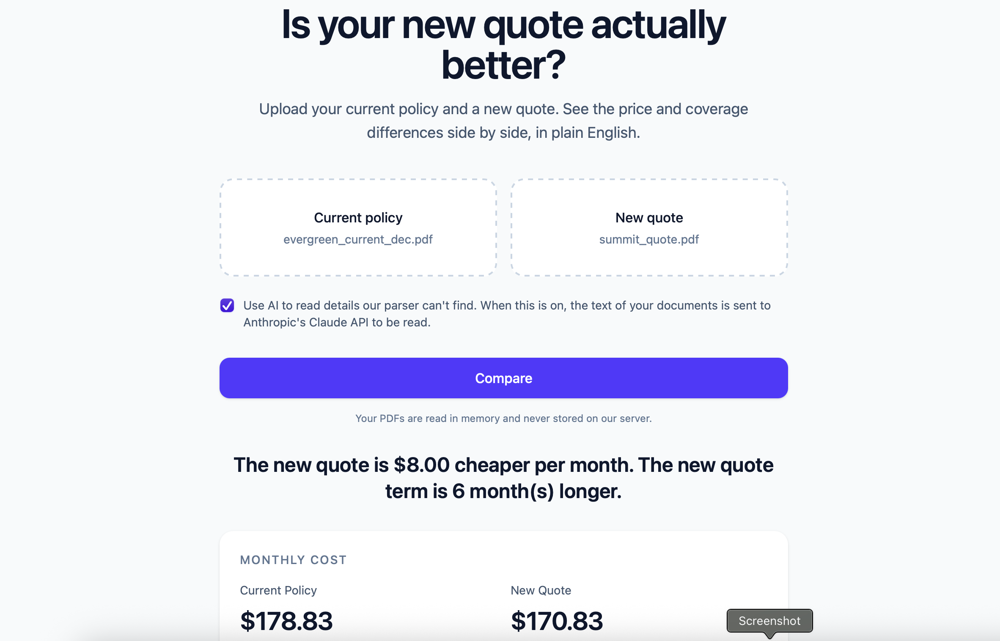

# InsureCompare

**Is your new auto insurance quote actually better?** Upload your current declarations page and a new quote (PDFs). InsureCompare reads both and explains the differences in price, coverage limits, deductibles and add-ons, in plain English.

[](https://github.com/dillonjames731/insurecompare/actions/workflows/tests.yml)

**Live demo:** https://insurecompare-a997.onrender.com
*(Free hosting: the first visit after a quiet period can take about a minute to wake up.)*



## Try it

Download the two fake sample documents and upload them on the live site:
- [Current policy (sample)](samples/evergreen_current_dec.pdf)
- [New quote (sample)](samples/summit_quote.pdf)

## What it does

- Compares **monthly cost** (normalizing 6-month vs 12-month terms)
- Compares **coverage limits** (bodily injury, property damage, uninsured motorist, PIP, medical payments)
- Compares **deductibles** (collision, comprehensive) and **add-ons** (rental, towing)
- Explains every difference in a plain-English sentence, e.g. *"The new quote is $8.00 cheaper per month"* and *"The new quote drops rental."*

## How it works

```
Browser (React)
   │  POST /compare/analyze   (2 PDFs + AI on/off)
   ▼
FastAPI
   1. Extract text from each PDF in memory (pdfplumber)
   2. Clean the text
   3. Parse fields with regex (fast, free, predictable)
   4. Ask Claude to fill only the fields regex missed (optional)
   5. Merge results, recording whether each value came from regex or AI
   6. Compare the two policies and return a JSON report
```

**Design decisions**
- **Regex first, AI second.** Regex is free and deterministic, so it always runs first and wins ties. The Claude API only fills gaps, using **structured outputs** (the Pydantic model doubles as the JSON schema), so the AI must return valid fields.
- **Privacy by design.** PDFs are processed **in memory** and never written to disk. The AI step can be turned off with a checkbox, and the app still works with regex only.
- **Graceful degradation.** If the AI service is down or no API key is set, the app falls back to regex instead of failing.
- **One server.** FastAPI serves both the API and the built React app, so there's one deploy and no CORS setup.

## Tech stack

**Backend:** Python 3.12, FastAPI, Pydantic, pdfplumber, Anthropic Claude API
**Frontend:** React 19, Vite, Tailwind CSS v4
**Quality:** pytest (40 tests: unit, mocked-AI, and API tests with TestClient), GitHub Actions CI
**Hosting:** Render

## Run it locally

```bash
git clone https://github.com/dillonjames731/insurecompare.git
cd insurecompare
python3 -m venv .venv && source .venv/bin/activate
pip install -r requirements.txt
cd frontend && npm install && npm run build && cd ..
uvicorn app.main:app --reload --reload-dir app
```
Open http://localhost:8000. To enable the AI step, create a `.env` file containing `ANTHROPIC_API_KEY=your-key`.

Run the tests: `python -m pytest -q`

## Limitations and future work

- With AI turned off, coverage limits aren't read yet (planned: a regex limit parser)
- Auto policies only. **Homeowners policies are next**
- Scanned (image-only) PDFs would need OCR
- Pin exact package versions in `requirements.txt`

*InsureCompare is a portfolio project and not insurance advice. Always read your full policy documents.*